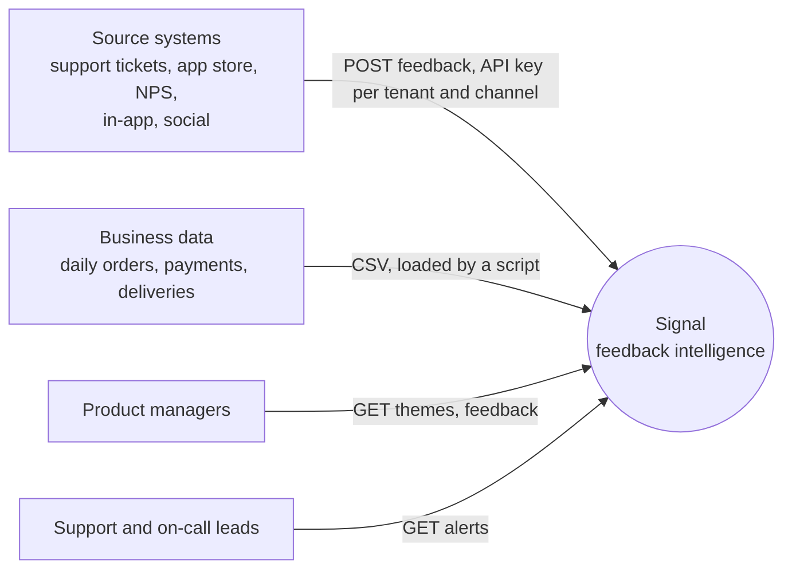
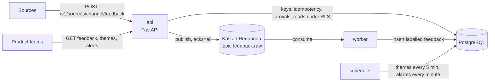
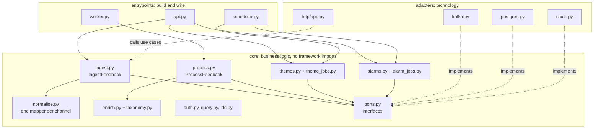
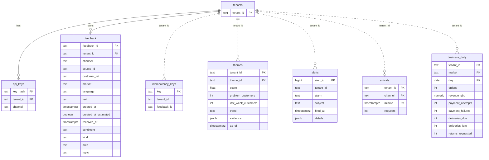

# Architecture overview

The four structural diagrams, as built in November 2026. Behaviour is in the sequence documents;
decisions are in `adr/`. The original design had more parts (Redis, Prometheus, retry and
dead-letter topics); what differs is listed under "As built" in the sequence documents.

## 1. System context

Who uses Signal and what flows in and out.

Two tenants (Ridgeline, Harbour Home) share one system. Signal sends nothing out yet: alarms are
stored and listed, not delivered.

## 2. Containers

The running parts and how they talk. One codebase and one image run as three processes (ADR 0005).

| Container | Responsibility | Database role |
|---|---|---|
| `api` | Authenticate, normalise, mask PII, publish; serve reads | `signal_api` (restricted, row-level security) |
| `worker` | Enrich each message and save it once | `signal` (owner) |
| `scheduler` | Rank themes, check alarms | `signal` (owner) |
| `redpanda` | Durable log between API and worker | – |
| `postgres` | System of record | – |

## 3. Backend modules

Hexagonal structure inside the monolith (ADR 0010). Dependencies point inward: `core/` imports
nothing from `adapters/` or any framework, and `tests/test_architecture.py` enforces it.

## 4. Entity-relationship diagram

Eight tables in three migrations. `feedback`, `themes`, `alerts` and `business_daily` have a
row-level security policy on `tenant_id`.

Solid lines are foreign keys; dotted lines are a `tenant_id` column without a foreign key.
`feedback_id` is derived from the idempotency key, so saving the same item twice leaves one row.
