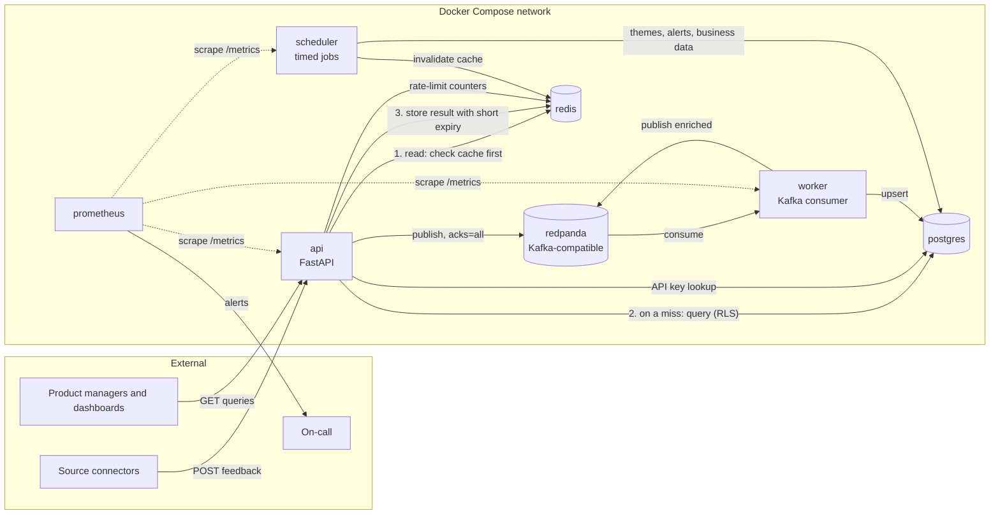
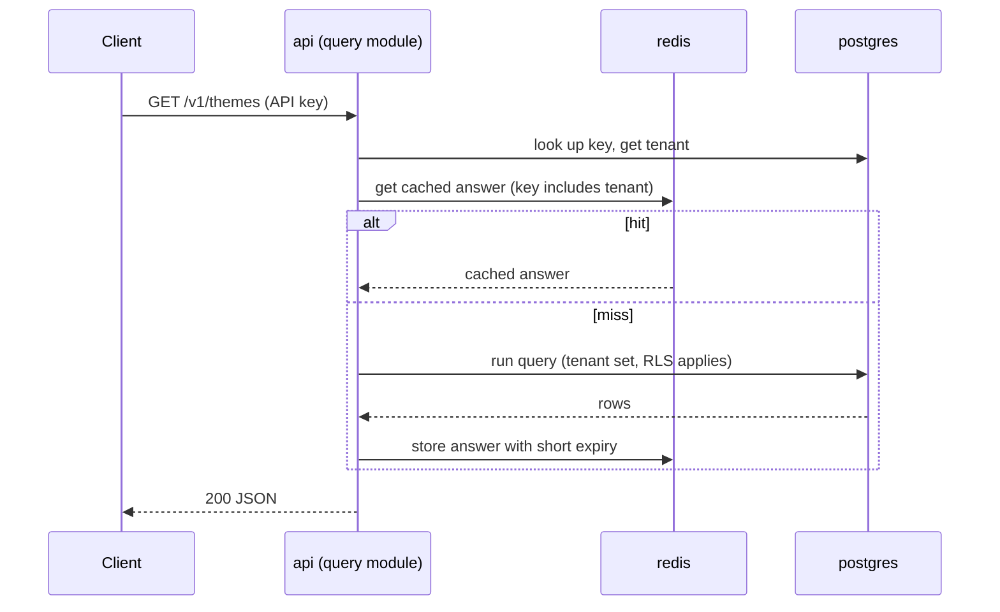

# Deployment

Local development runs everything with Docker Compose. One image provides three entry points (see [ADR 0005](adr/0005-modular-monolith-three-entry-points.md)).

## Read path (cache-aside)

There is no service between the API and PostgreSQL. The query module inside the API is the only code that reads the database, and PostgreSQL row-level security keeps each tenant to its own rows.

The scheduler clears the affected cache entries after it recomputes themes. If Redis is down, the API skips the cache and reads from PostgreSQL, so Redis is an optimisation and not a dependency for correctness. A connection pooler (see Notes) is the only component between the API and PostgreSQL in production.

## Containers

| Container | Role | Depends on | Ports (local) |
|---|---|---|---|
| `api` | HTTP ingest and query endpoints | postgres, redis, redpanda | HTTP, published to host |
| `worker` | Normalise, enrich, save; scale by adding replicas up to the partition count | redpanda, postgres | none |
| `scheduler` | Theme job, alarm checks, daily business data load; run a single instance | postgres, redis | none |
| `redpanda` | Kafka-compatible broker with topics for ingest, enriched, retry and DLQ | none | Kafka listener, internal |
| `postgres` | System of record, with the `signal_api` and `signal_internal` roles and RLS policies | none | internal |
| `redis` | Query cache and rate-limit counters | none | internal |
| `prometheus` | Scrapes metrics, evaluates alert rules | api, worker, scheduler | UI, published to host |

## Notes

- Only the API and Prometheus UI are published to the host. Datastores stay on the internal network.
- `/metrics` is exposed to the internal network only.
- Configuration (database URLs, broker address, secrets) comes from environment variables, with no secrets in the image.
- Database migrations run as a one-off step before the API and workers start, using expand-and-contract so old and new versions can run side by side.
- Each datastore uses a named volume so data survives restarts.
- Locally PostgreSQL and the broker are single instances and therefore single points of failure. In production both would run with replicas across availability zones, behind a pooler for PostgreSQL.
