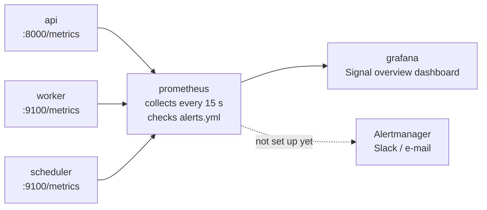

# Monitoring

Signal is watched with Prometheus and Grafana ([ADR 0011](adr/0011-prometheus-and-grafana-for-monitoring.md)).
They answer one question: is Signal itself healthy? The business alarms (a flood from one source,
an incident, a slow decline) are a different thing; they live in the `alerts` table ([ADR 0008](adr/0008-three-alarms-with-quiet-period.md)).



## Open it

```bash
docker compose up --build -d
```

- Grafana: http://localhost:3000, dashboard **Signal overview** (opens as the home page). Viewing
  needs no login; editing needs `admin` / `admin`.
- Prometheus: http://localhost:9090. **Status → Targets** shows whether api, worker and scheduler
  answer; **Alerts** shows the rules below and whether they fire.
- Raw numbers of one process: `curl localhost:8000/metrics`.

Send some traffic (for example the replay script, TESTING.md level 5) and the graphs fill within 15 seconds.

## What each process measures

All metric names start with `signal_`. Code: `src/signal_app/adapters/metrics.py`.

| Process | Metric | Kind | What it tells you |
|---|---|---|---|
| api | `signal_http_requests_total{method, route, status}` | counter | Requests per endpoint and status code. `route` is the template (`/v1/sources/{channel}/feedback`), so made-up URLs cannot create new series. |
| api | `signal_http_request_duration_seconds{method, route}` | histogram | How long requests take; gives p50, p95, p99. |
| api | `signal_feedback_received_total{channel, status}` | counter | Feedback posted per channel and answer (202 new, 200 duplicate, 4xx bad input, 503 Kafka or PostgreSQL down). Unknown channels are counted as `unknown`. |
| worker | `signal_worker_messages_total{result}` | counter | `saved`, `skipped` (unreadable, lost until a dead-letter topic exists) or `retry` (database problem). |
| worker | `signal_worker_processing_seconds` | histogram | Time to label and save one message. |
| worker | `signal_worker_lag_messages{partition}` | gauge | Messages waiting in Kafka that this worker has not processed. Measured every 10 seconds. |
| scheduler | `signal_scheduler_task_runs_total{task, result}` | counter | Runs of `themes`, `alarms` and `declines`, `ok` or `failed`. |
| scheduler | `signal_scheduler_task_duration_seconds{task}` | histogram | How long each task takes. |
| scheduler | `signal_scheduler_last_success_timestamp_seconds{task}` | gauge | When each task last succeeded. |
| scheduler | `signal_themes_ranked` | gauge | Themes in the latest ranking, all tenants. |
| scheduler | `signal_alerts_fired_total{alarm}` | counter | Business alarms fired, by kind. |

The scheduler's label is `task`, not `job`, because Prometheus adds its own `job` label
(`api`, `worker`, `scheduler`) to everything it collects.

## The dashboard

`monitoring/grafana/dashboards/signal-overview.json`, loaded automatically. Four rows:

1. **At a glance:** requests per second, 5xx share, API p99, messages waiting in Kafka, themes
   ranked, seconds since themes were last computed. Green, orange or red against the alert limits.
2. **API:** requests by endpoint, latency p50/p95/p99, feedback by channel, ingest answers by status.
3. **Worker:** messages by result, lag by partition, time per message.
4. **Scheduler and alarms:** task runs, task duration, business alarms fired.

## Alert rules

`monitoring/alerts.yml`, tested by `monitoring/alerts_test.yml` (`promtool test rules`, also in CI).

| Alert | Fires when | Severity | Usually means |
|---|---|---|---|
| `SignalProcessDown` | a process has not answered for 1 minute | page | a container crashed |
| `SignalApiErrors` | more than 5% of requests are 5xx for 5 minutes | page | Kafka or PostgreSQL is down |
| `SignalApiSlow` | p99 above 500 ms for 10 minutes | ticket | database slow, or too much load for one process |
| `SignalWorkerBehind` | more than 5,000 messages waiting for 10 minutes | ticket | not enough workers, or a slow database |
| `SignalWorkerRetrying` | the worker retries for 5 minutes | page | PostgreSQL unreachable from the worker |
| `SignalUnreadableMessages` | any message skipped in 15 minutes | ticket | a source sends something the worker cannot read |
| `SignalThemesStale` | themes not recomputed for 15 minutes | ticket | the scheduler's theme task keeps failing |

"page" means wake someone up; "ticket" means look at it during working hours. Both only show in
Prometheus for now.

## How it was checked

- 11 unit tests in `tests/test_metrics.py`: each counter moves when it should, unknown channels and
  paths share one label, `/metrics` does not count itself, lag is computed per partition.
- `promtool check config` and `promtool test rules` (6 scenarios) pass, locally and in CI.
- A live run: the real API and scheduler against PostgreSQL, scraped by Prometheus 3.5. All targets
  came up, every dashboard query ran without error, and the 5xx share and the
  `SignalProcessDown` alert reacted as expected. Grafana itself could not be started in that
  environment; the dashboard was checked by running each of its queries against Prometheus.

## Limitations and next steps

- **Nobody is notified.** Alerts show in Prometheus only. Next: Alertmanager with a Slack or e-mail
  receiver, which would also carry the business alarms.
- **The API's `/metrics` is on the public port.** In Docker Compose anyone who can reach port 8000
  can read it. It holds no customer data, only counts. In production, block `/metrics` at the
  ingress or load balancer, or serve it on a separate internal port as the worker does.
- **One API process.** Metrics are kept per process. Running uvicorn with several workers would need
  prometheus-client's multiprocess mode; in Kubernetes each pod is scraped on its own instead.
- **Several workers** (`docker compose up --scale worker=3`) share the name `worker:9100`, so
  Prometheus sees only one of them at a time. Kubernetes service discovery fixes this.
- **No logs or traces in Grafana.** Logs are plain text in `docker compose logs`. Next: JSON logs and
  Loki, then OpenTelemetry traces (planned in ADR 0009).
- **Kafka itself is not scraped.** Redpanda exposes its own metrics; the worker's lag gauge covers
  the most important one.
