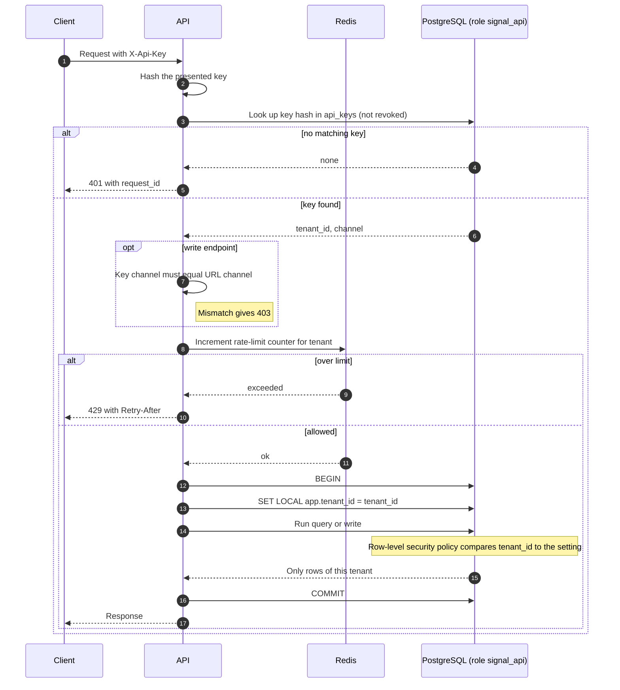

# Sequence: authentication and tenant scoping

How an API key identifies a tenant and how that tenant is enforced in the database. Related: [ADR 0004](adr/0004-tenant-model-and-row-level-security.md).

## Request authentication

## Notes

- Keys are stored only as hashes, scoped to one tenant and one channel, and can be revoked without deleting the row.
- The tenant always comes from the key, never from a header, query parameter or payload field.
- `SET LOCAL` is transaction-scoped, so the setting cannot leak to another request on a pooled connection. If the setting is missing, the policy returns no rows.
- The API database role has row-level security enforced. Workers and the scheduler use a separate internal role that bypasses it, and take the tenant from the Kafka envelope or iterate tenants themselves.
- The key lookup itself happens before the tenant is known, so it uses a narrowly scoped lookup that only reads `api_keys`.
- `/health` is unauthenticated; `/metrics` is reachable on the internal network only.
- Read endpoints never return customer references or personal data.
