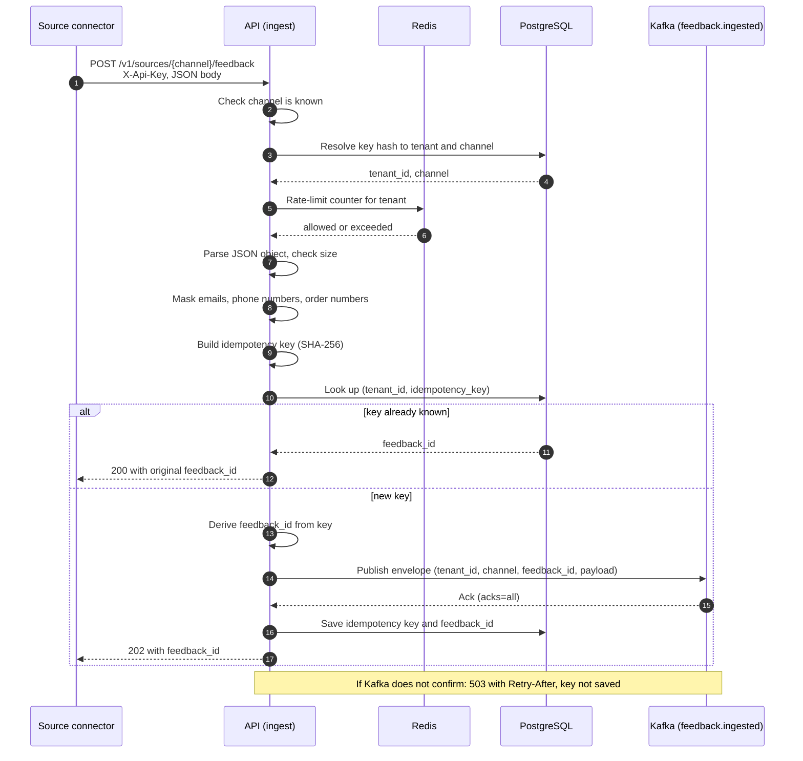

# Sequence: ingestion

How one feedback item gets from a source into the durable log. Related: [ADR 0001](adr/0001-kafka-as-durable-ingest-log.md), [ADR 0002](adr/0002-idempotency-key-and-publish-first.md).

## Notes

- Checks run in a fixed order and each failure has its own 4xx: unknown channel 404, invalid key 401, key for another channel 403, rate limit 429 with `Retry-After`, invalid JSON 400, not an object 422, too large 413. Bad input never produces a 5xx.
- The idempotency key is the SHA-256 of tenant, channel and the source's own ID. If there is no source ID, the `Idempotency-Key` header is used; if neither exists, a hash of the canonicalised payload.
- Publish happens before the key is saved. A crash in between can duplicate a Kafka message but cannot lose an item; downstream upserts collapse the duplicate.
- The tenant in the envelope comes from the API key, never from the payload.
- Redis down: rate limiting is skipped with a warning (fail open). Kafka or PostgreSQL down: the API returns 503 (fail closed).
- Field-level problems such as bad dates or missing text are not rejected here; the normaliser handles them.
