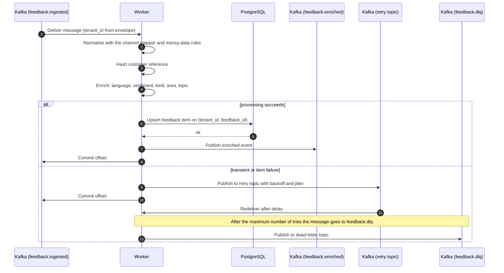
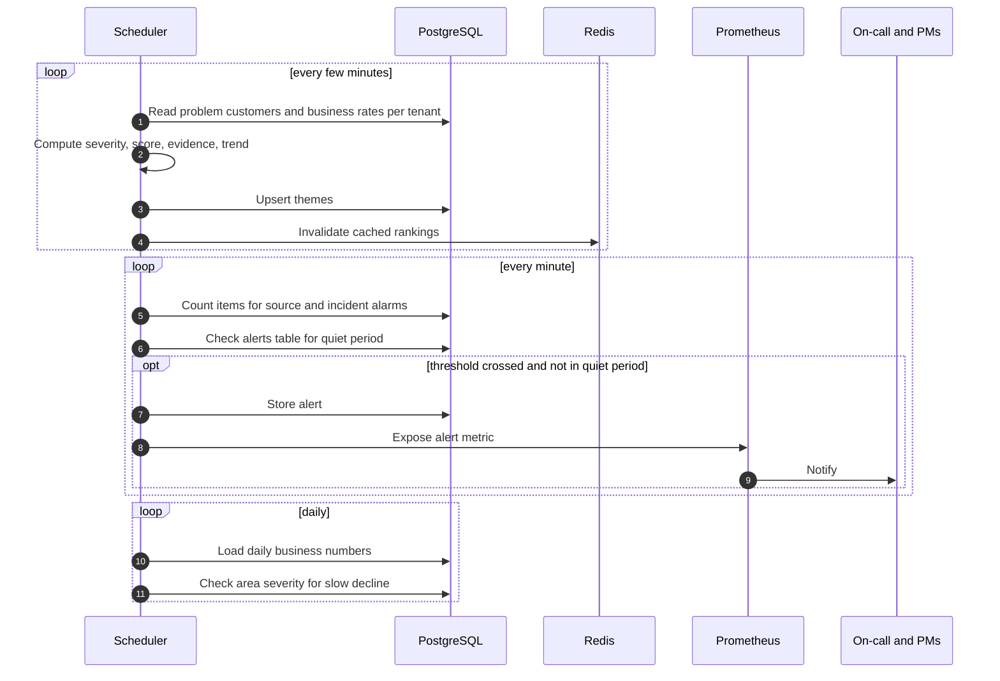

# Sequence: processing

How a worker turns a raw message into a labelled feedback item, and how themes and alarms are derived from it. Related: [ADR 0006](adr/0006-rule-based-enrichment.md), [ADR 0007](adr/0007-theme-key-and-impact-score.md), [ADR 0008](adr/0008-three-alarms-with-quiet-period.md).

## Per-item processing

## Periodic jobs

## Notes

- Delivery is at-least-once. The offset is committed only after the write succeeds, and the write is an upsert, so a crash mid-item just means the item is processed again without a duplicate.
- The tenant for a worker write comes from the message envelope set by the API, never from the payload. Workers use the internal database role, which bypasses row-level security, so a test checks that stored rows carry the envelope tenant.
- A single failing enricher does not fail the item: the other labels are saved, the failure is marked, and it is retried.
- A message that exhausts its retries lands in the dead-letter topic so it cannot block its partition; a non-empty DLQ raises an operational alert.
- If a theme run fails, the last good rankings stay in place and a stale-rankings alert fires when they get too old.
- After any alarm, the same subject stays quiet for a fixed period.
