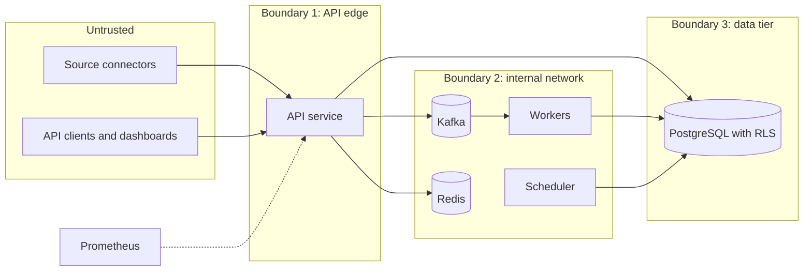

# Threat model

STRIDE-style analysis of Signal. Related: [ADR 0004](adr/0004-tenant-model-and-row-level-security.md), [authentication sequence](sequence-authentication.md).

## Assets

| Asset | Why it matters |
|---|---|
| Feedback text and labels | May contain personal data; core product data |
| Customer references | Hashed identifiers; linkable to a person if the salt leaks |
| API keys | Grant write access for one tenant and channel |
| Business numbers | Commercially sensitive per tenant |
| Raw payloads in the ingest log | Only copy of the unprocessed input, retained briefly |
| Themes, rankings and alerts | Drive decisions; integrity matters |
| Availability of ingest | Lost or delayed feedback hides incidents |

## Trust boundaries

1. Internet to API: everything from senders and readers is untrusted.
2. API to internal services: the API is trusted to put the correct tenant in the message envelope.
3. Application to database: the API role is constrained by row-level security; worker and scheduler roles are not.

## Threats and mitigations

| ID | STRIDE | Threat | Asset or boundary | Mitigation |
|---|---|---|---|---|
| T1 | Spoofing | Attacker uses a stolen or guessed API key | API keys, boundary 1 | Keys are long random values stored only as hashes; scoped to one tenant and one channel; revocable; never logged; rotation by issuing a new key and revoking the old |
| T2 | Spoofing | Sender claims another tenant in the payload or a header | Tenant isolation | Tenant is derived only from the key; the payload cannot set it; the Kafka envelope tenant is set by the API |
| T3 | Spoofing | Key for one channel used on another | API keys | Key bound to channel; mismatch returns 403 |
| T4 | Tampering | Malicious payload alters stored data or injects into queries | Feedback data | Parameterised queries only; strict JSON-object validation and size limits; the normaliser treats all fields as untrusted; text escaped by consumers |
| T5 | Tampering | Replay or duplication inflates themes and triggers false alarms | Themes, alerts | Idempotency keys; alarms count unique customers by creation time; source-misbehaving alarm |
| T6 | Tampering | Message on the internal topics forged or modified | Kafka | Topics not exposed outside the internal network; broker access restricted; production uses authentication and TLS |
| T7 | Repudiation | Cannot tell who sent or changed what | All | Structured logs with `request_id`, `tenant_id`, `channel`, outcome; alerts stored with details; deletion requests logged |
| T8 | Information disclosure | Cross-tenant read through a missing filter | Tenant isolation, boundary 3 | Row-level security on every table for the API role with `SET LOCAL` per request; missing setting returns no rows; tests per policy |
| T9 | Information disclosure | Cross-tenant write by a worker | Tenant isolation | Tenant taken from the envelope only; unit test asserts stored rows carry the envelope tenant; code review on the internal role; residual risk accepted |
| T10 | Information disclosure | Personal data stored or logged | Feedback text, logs | Emails, phone numbers and order numbers masked at ingest, before publish; customer reference salted and hashed; raw payload not stored in PostgreSQL; logs never contain raw text; read endpoints never return personal data; per-customer deletion |
| T11 | Information disclosure | Error messages leak internals | API | One error format with `request_id`; no stack traces or SQL in responses |
| T12 | Information disclosure | Metrics or docs expose internals | Operations | `/metrics` on the internal network only; `/docs` optional and disabled where not needed |
| T13 | Denial of service | Burst or flood from one tenant starves others | Availability | Per-tenant rate limiting returning 429; Kafka buffers bursts; consumers scale to partition count; request size limits |
| T14 | Denial of service | Poison message blocks processing | Workers | Bounded retries, then dead-letter topic; DLQ alert |
| T15 | Denial of service | Redis or dependency outage | Availability | Rate limits fail open with a warning; queries fall back to PostgreSQL; Kafka or database outage fails closed with 503 and `Retry-After` |
| T16 | Denial of service | Bad input crashes the API | Availability | Every invalid input returns 4xx; global exception handling; fuzz and property tests on input paths; any request-caused 5xx pages on-call |
| T17 | Elevation of privilege | API role bypasses row-level security | Boundary 3 | API connects as a role without bypass rights; policies forced on tables; migrations run under a separate owner role |
| T18 | Elevation of privilege | Compromised worker or scheduler reads all tenants | Boundary 2 | Internal role not reachable from the edge; least privilege grants; no direct network exposure; secrets via environment, not in the image |
| T19 | Elevation of privilege | Deletion endpoint abused to remove another tenant's data | Admin endpoints | Deletion runs under the tenant-scoped API role, so only the caller's rows can match |

## Input validation summary

| Check | Response |
|---|---|
| Unknown channel | 404 |
| Missing or invalid key | 401 |
| Key not valid for the channel | 403 |
| Rate limit exceeded | 429 with `Retry-After` |
| Malformed JSON | 400 |
| Not a JSON object | 422 |
| Body too large | 413 |
| Kafka unavailable | 503 with `Retry-After` |

Field-level problems (dates, ratings, missing text) are handled by the normaliser: fixed or flagged where possible, otherwise skipped and counted. They never turn into server errors.

## Residual risks

- Workers and the scheduler bypass row-level security and depend on code and tests for tenant correctness.
- Masking is rule-based; unusual personal data formats may pass through.
- Masking is applied to the text before publish, so the raw log holds masked text; other payload fields are kept as sent for the retention window and must be treated as sensitive.
- Local development uses single instances and plain connections; production hardening (TLS, broker authentication, secret management, replicas) is required before real data.
